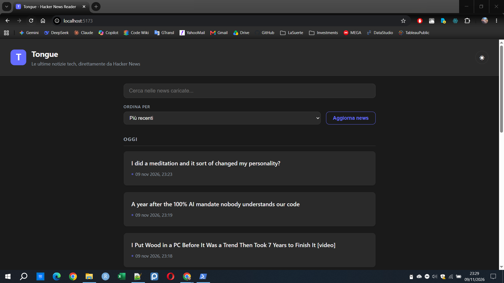
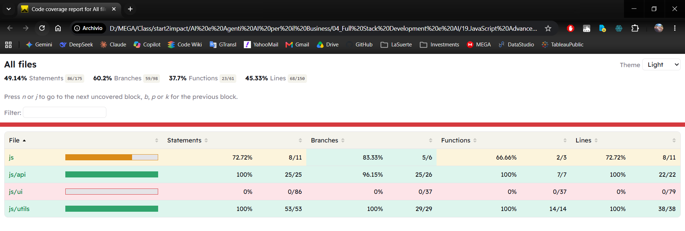

# Tongue - Hacker News Reader

A JavaScript application that brings the latest tech news from [Hacker News](https://news.ycombinator.com/) directly to your browser. Built for the Tongue project to democratize access to technology information.

[](https://vite.dev/)
[](https://vitest.dev/)
[](https://developer.mozilla.org/en-US/docs/Web/JavaScript)

**Live demo:** [https://tongue-hacker-news-gg.netlify.app](https://tongue-hacker-news-gg.netlify.app)

---

## Overview

Tongue is a fictional Italian media company that delivers news in a fast, clear, and accessible way. This project is a demo application that fetches the latest stories from Hacker News, displays the first 10, and lets the user load more in batches of 10.

Each news item shows:

- **Title** (clickable, opens the original article in a new tab)
- **URL** (the original source)
- **Publication date** (formatted in Italian)

The application is built entirely with vanilla JavaScript (ES6+), uses Vite as bundler and dev server, Axios for HTTP requests, and Vitest for testing.

---

## Screenshots

### Application



### Test coverage



---

## Features

- **Latest news from Hacker News**: the first 10 stories are loaded on startup, more can be loaded in batches of 10 via the "Load more" button.
- **Search**: filter loaded stories by title (client-side).
- **Sort**: order loaded stories by newest, oldest, title A-Z, or title Z-A.
- **Group by date**: when sorted by date, stories are grouped under day headers ("Oggi", "Ieri", etc.).
- **Refresh**: reload the latest stories from scratch with a single click.
- **Dark mode**: toggle between light and dark theme; preference is saved in `localStorage`.
- **Local cache**: loaded stories are cached in `localStorage` for 10 minutes to reduce API calls.
- **Skeleton loading**: modern skeleton placeholders while data is being fetched.
- **Back-to-top button**: appears after scrolling, smooth scroll to top.
- **Responsive layout**: works on desktop and mobile.

---

## Architecture

The project follows a clean separation of concerns, inspired by the Repository Pattern. The goal is to isolate the API layer from the UI layer, making each part independently testable.

```text
src/
├── js/
│   ├── api/
│   │   └── HackerNewsRepository.js   # API layer (Repository Pattern)
│   ├── ui/
│   │   ├── NewsRenderer.js           # DOM rendering
│   │   ├── LoadMoreButton.js         # Button state management
│   │   ├── ThemeManager.js           # Light/dark theme toggle
│   │   ├── SearchBar.js              # Search input binding
│   │   ├── BackToTop.js              # Back-to-top button
│   │   └── NewsControls.js           # Sort control binding
│   ├── utils/
│   │   ├── pagination.js             # Pure function for pagination
│   │   ├── dateFormatter.js          # Pure function for date formatting
│   │   ├── search.js                 # Pure function for title filtering
│   │   ├── sortStories.js            # Pure function for sorting
│   │   ├── groupByDate.js            # Pure function for grouping by day
│   │   └── cache.js                  # Pure functions for cache validity
│   ├── config.js                     # Singleton configuration via ES modules
│   ├── storage.js                    # Safe localStorage wrapper
│   └── main.js                       # Entry point, orchestration
├── css/
│   └── style.css
└── img/
    └── logo.svg
```

### Design patterns used

1. **Repository Pattern** (`HackerNewsRepository.js`): encapsulates all network calls to the Hacker News API. The UI layer never calls Axios directly. This makes the API layer easy to mock in tests and easy to replace if the data source changes.

2. **Singleton via ES Modules** (`config.js`): the configuration object is exported from a single module. Since ES modules are executed only once and cached, every importer receives the same frozen object. This is the cleanest way to implement a Singleton in modern JavaScript.

### Key technical decisions

- **Promise.allSettled for batch loading**: Hacker News sometimes returns `null` for deleted or dead stories. Using `Promise.all` would reject the entire batch; `Promise.allSettled` allows the application to keep the valid items and skip the invalid ones.
- **Pure functions for pagination and date formatting**: these functions have no side effects and no dependencies, which makes them trivial to test and reason about.
- **Dependency injection in the Repository**: the Axios client is injected via the constructor. In production, the default (`axios`) is used. In tests, a mock client is injected, so no real network calls are made.

---

## Tech Stack

| Layer                | Technology                          |
| -------------------- | ----------------------------------- |
| Language             | JavaScript (ES6+)                   |
| Bundler & Dev server | [Vite](https://vite.dev/)           |
| HTTP client          | [Axios](https://axios-http.com/)    |
| Testing              | [Vitest](https://vitest.dev/)       |
| Coverage             | `@vitest/coverage-v8`               |
| Formatter            | [Prettier](https://prettier.io/)    |
| Hosting              | [Netlify](https://www.netlify.com/) |

---

## Getting Started

### Prerequisites

- Node.js 20+ (LTS recommended)
- npm 10+

### Installation

```bash
git clone https://github.com/GG-script-code/tongue-hacker-news.git
cd tongue-hacker-news
npm install
```

### Environment variables

Copy `.env.example` to `.env`:

```bash
cp .env.example .env
```

The default values point to the public Hacker News API. No API key is required.

### Development

```bash
npm run dev
```

Open [http://localhost:5173](http://localhost:5173).

### Build for production

```bash
npm run build
npm run preview
```

The optimized output is generated in `dist/`.

### Run tests

```bash
npm run test:run        # Single run
npm run test:coverage   # With coverage report
```

---

## Testing

The project has **39 automated tests** covering the critical modules:

- **HackerNewsRepository** (11 tests): ID fetching, story normalization, fallback URL construction, handling of `null` responses, batch filtering, cache hit/miss/expiry.
- **pagination** (5 tests): first page, second page, last partial page, out-of-bounds page, invalid input.
- **dateFormatter** (5 tests): valid timestamp, `null`, `undefined`, `0`, year extraction.
- **cache** (5 tests): validity check for recent/expired/invalid timestamps, key building.
- **search** (4 tests): empty query, case-insensitive filtering, no match, invalid input.
- **sortStories** (6 tests): newest first, oldest first, title A-Z, title Z-A, no mutation, invalid input.
- **groupByDate** (3 tests): grouping by day, "Oggi"/"Ieri" labels, full date label for older dates.

### Coverage strategy

Coverage is intentionally focused on the modules that contain business logic and data handling:

| Module                    | Statements | Branch | Functions | Lines |
| ------------------------- | ---------- | ------ | --------- | ----- |
| `config.js`               | 100%       | 75%    | 100%      | 100%  |
| `HackerNewsRepository.js` | 100%       | 96.15% | 100%      | 100%  |
| `dateFormatter.js`        | 100%       | 100%   | 100%      | 100%  |
| `pagination.js`           | 100%       | 100%   | 100%      | 100%  |
| `search.js`               | 100%       | 100%   | 100%      | 100%  |
| `sortStories.js`          | 100%       | 100%   | 100%      | 100%  |
| `groupByDate.js`          | 100%       | 100%   | 100%      | 100%  |
| `cache.js`                | 100%       | 100%   | 100%      | 100%  |
| `storage.js`              | 62.5%      | 100%   | 66.66%    | 62.5% |

The `src/js/ui/` modules (`NewsRenderer`, `LoadMoreButton`, `ThemeManager`, `SearchBar`, `BackToTop`, `NewsControls`) are **intentionally excluded** from testing. They contain no business logic (only DOM manipulation and simple state toggling) and testing them would require a full DOM environment (jsdom) with no meaningful gain in confidence.

`storage.js` is covered indirectly through the repository tests: the cache tests exercise the `safeGet` and `safeSet` paths. The uncovered lines are the error branches of the `try/catch` blocks, which only trigger on storage quota errors or private-mode restrictions and are not reproducible in a Node test environment without heavy mocking.

This choice aligns with the project brief, which asks for tests on "critical functions, particularly those related to calculations and data handling".

---

## Project Structure

```text
tongue-hacker-news/
├── index.html
├── package.json
├── vite.config.js
├── vitest.config.js
├── .env.example
├── .prettierrc
├── .gitignore
├── README.md
├── docs/
│   ├── app-screenshot.png
│   └── coverage.png
├── src/
│   ├── js/
│   │   ├── api/
│   │   │   └── HackerNewsRepository.js
│   │   ├── ui/
│   │   │   ├── NewsRenderer.js
│   │   │   ├── LoadMoreButton.js
│   │   │   ├── ThemeManager.js
│   │   │   ├── SearchBar.js
│   │   │   ├── BackToTop.js
│   │   │   └── NewsControls.js
│   │   ├── utils/
│   │   │   ├── pagination.js
│   │   │   ├── dateFormatter.js
│   │   │   ├── search.js
│   │   │   ├── sortStories.js
│   │   │   ├── groupByDate.js
│   │   │   └── cache.js
│   │   ├── config.js
│   │   ├── storage.js
│   │   └── main.js
│   ├── css/
│   │   └── style.css
│   └── img/
│       └── logo.svg
└── tests/
    ├── HackerNewsRepository.test.js
    ├── pagination.test.js
    ├── dateFormatter.test.js
    ├── cache.test.js
    ├── search.test.js
    ├── sortStories.test.js
    └── groupByDate.test.js
```

---

## Development Notes

- **Vite 8**: the project uses Vite 8. Configuration is minimal and uses native ES modules.
- **Path alias @**: imports use `@/js/...` instead of long relative paths. Configured in both `vite.config.js` and `vitest.config.js` for consistency across build and test.
- **Prettier**: code style is enforced with a project-level `.prettierrc`. Run `npx prettier --write .` to format the entire project.
- **No external CSS framework**: the styling is custom and minimal, with CSS variables for colors and spacing. This keeps the bundle small and the code readable.

---

## License

This project was developed as part of a JavaScript Advanced course assignment. The client "Tongue" is fictional.

---

Built with care by [GG-script-code](https://github.com/GG-script-code).
